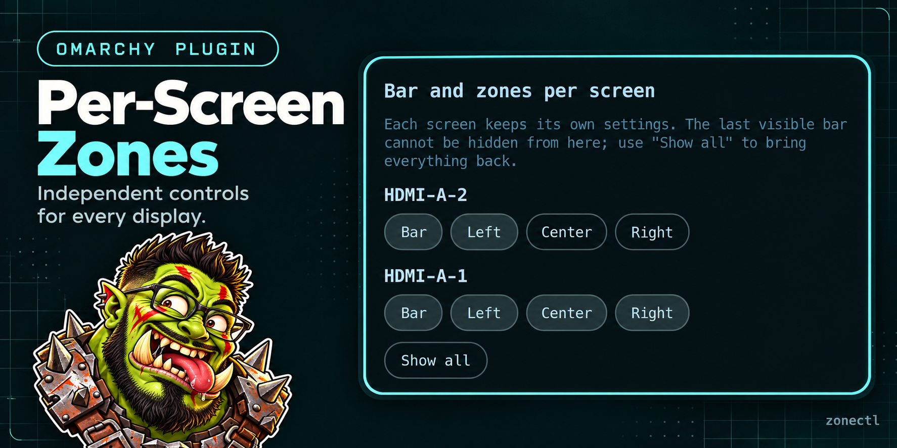

# Per-Screen Zones (`zonectl`)



An Omarchy bar widget that controls, **per screen**, whether the native bar
is shown and which of its three sections (`left`, `center`, `right`) are
visible. It does not replace the bar: widgets, panels, theming and layout
stay owned by Omarchy.

## Install

From this repository:

```sh
omarchy plugin add https://github.com/ApachaiZ/omarchy-zonectl.git --enable
omarchy restart shell
```

For local development the checkout lives in
`~/.config/omarchy/plugins/zonectl/`; enable it with
`omarchy plugin enable zonectl --section left` and restart the shell.

After editing the plugin's QML, restart the shell: the shell keeps the
loaded component in its cache.

The plugin id is `zonectl`. Omarchy reserves the `omarchy.*` namespace for
its built-ins, so a third-party plugin cannot use `omarchy.zonectl`; the
shell and the marketplace validator both reject it.

## Usage

Click the monitor glyph in the bar to open the panel. It lists the connected
screens (and configured screens that are currently disconnected), each with
four buttons: **Bar**, **Left**, **Center**, **Right**. **Show all** resets
everything. Escape closes the panel.

The button lives in the section where the widget is placed. If you hide that
section on a screen, the button disappears from that screen but remains
available on the others; the configuration can still be edited by hand or
through IPC.

Move the widget with:

```sh
omarchy bar move zonectl --section right
```

## Configuration

Everything is stored inline in the widget's entry inside
`~/.config/omarchy/shell.json`:

```json
{
  "id": "zonectl",
  "screens": {
    "DP-1": { "bar": true, "left": true, "center": true, "right": true },
    "HDMI-A-1": { "bar": true, "left": true, "center": false, "right": false }
  }
}
```

- A screen or a key that is absent means "shown".
- `bar: false` hides that screen's whole bar (it stays mapped off-screen,
  like the native bar-hidden toggle).
- Screen names are the ones reported by `hyprctl monitors` (`DP-1`,
  `HDMI-A-1`, `eDP-1`, ...).

### IPC

```sh
# a single setting
omarchy-shell zonectl set HDMI-A-1 center false
omarchy-shell zonectl set HDMI-A-1 bar true

# show everything again
omarchy-shell zonectl reset
```

Accepted `set` values: `true`, `false`, `on`, `off`, `1`.

## Guard rail

The last screen whose bar is visible cannot be hidden from the plugin or
from IPC: show another screen first. This keeps the UI reachable. The native
`omarchy toggle bar` remains available to hide every bar at once.

## How it works

Every bar surface builds one instance of this widget. The instance finds its
own panel through `QsWindow.window` and only touches that panel:

1. **Whole bar**: `Binding`s on the `PanelWindow`'s `margins.*` and
   `exclusionMode`, exactly the mechanism the native bar-hidden toggle uses.
   The native bindings are restored when the widget is destroyed
   (`Binding.RestoreBindingOrValue`).
2. **Sections**: the `left`/`center`/`right` sections are found in the bar's
   item tree by their shape markers (`region` for the side sections,
   `entries` + `anchorEntry` for the center), and `visible` is applied to
   every match found. No private name from `Bar.qml` is used.
3. The global `bar-off` toggle is read by the plugin (file + probe), because
   its margin bindings replace the native bar's own.

Disabling the plugin (`omarchy plugin disable zonectl`) destroys the
instances and restores margins, exclusion and sections: the original bar is
back on every screen.

## Remove

```sh
omarchy plugin remove zonectl
```

Removal disables the plugin first, so margins, exclusion and sections are
restored on every screen before the folder is deleted.

## Validation

```sh
omarchy plugin validate ~/.config/omarchy/plugins/zonectl
QMLLINT=$(command -v qmllint || echo /usr/lib/qt6/bin/qmllint)
"$QMLLINT" -I "$OMARCHY_PATH/shell" \
  ~/.config/omarchy/plugins/zonectl/BarWidget.qml \
  ~/.config/omarchy/plugins/zonectl/Panel.qml
```

Both commands exit without an error. The manifest declares
`"license": "MIT"`; the repository also ships `LICENSE` and this `README.md`.

## Privacy and security

- **No network and no telemetry.** The plugin makes no HTTP requests, opens
  no sockets, and collects no analytics.
- **Local-only state.** The per-screen map lives in
  `~/.config/omarchy/shell.json`; screen names are read from Quickshell and
  stored there only. Nothing leaves the machine.
- **No elevated privileges.** The plugin never requests elevated rights, runs
  an installer, or downloads anything, and it has no install hooks.
- **One fixed subprocess.** It runs a single `bash -c` test for the local
  `bar-off` flag; no user or IPC input is interpolated into the command.
- **No secrets or hardware identifiers.** Only the compositor's output names
  are used; no serial numbers, IP addresses, or hardware identifiers are
  read or stored.

## Known limits

- Section hiding relies on `Bar.qml`'s internal shape markers (`region`,
  `entries`, `anchorEntry`). An Omarchy update that renames them would break
  zone hiding (the whole-bar control would keep working). After a large
  update, compare with
  `/usr/share/omarchy/shell/plugins/bar/Bar.qml`.
- `visible=false` on a section does not close a panel that is already open;
  close the panel before changing that section.
- Settings live in the widget's entry: `omarchy plugin disable` removes it,
  so re-enabling starts again from "everything shown".
