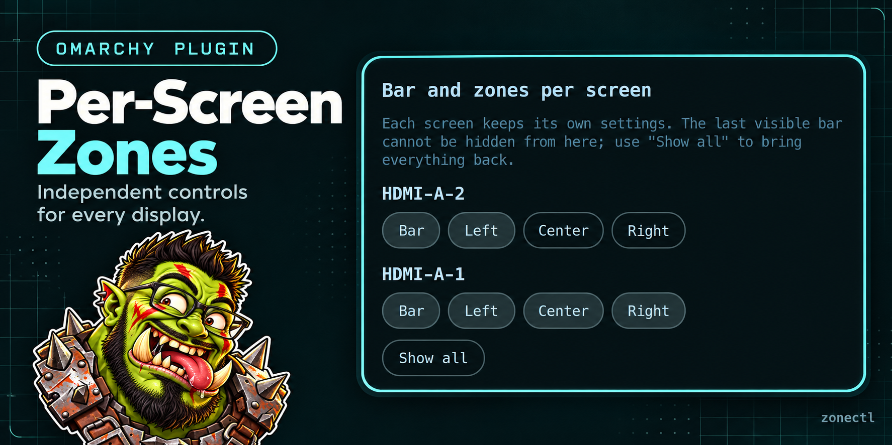

# Per-Screen Zones (`zonectl`)



An Omarchy bar widget that controls, **per screen**, whether the native bar
is shown and which of its three sections (`left`, `center`, `right`) are
visible. It does not replace the bar: widgets, panels, theming and layout
stay owned by Omarchy.

## Install

From this repository:

```sh
omarchy plugin add https://github.com/ApachaiZ/omarchy-zonectl.git --enable
omarchy restart shell
```

For local development the checkout lives in
`~/.config/omarchy/plugins/zonectl/`; enable it with
`omarchy plugin enable zonectl --section left` and restart the shell.

After editing the plugin's QML, restart the shell: the shell keeps the
loaded component in its cache.

The plugin id is `zonectl`. Omarchy reserves the `omarchy.*` namespace for
its built-ins, so a third-party plugin cannot use `omarchy.zonectl`; the
shell and the marketplace validator both reject it.

## Usage

Click the monitor glyph in the bar to open the panel. Each connected screen
(and each configured screen that is currently disconnected) gets a card with
its name, a connection dot, and a 2×2 grid of **Bar**, **Left**, **Center**
and **Right** toggles; an active toggle is highlighted. **Show all** resets
everything.

Keyboard: arrow keys move the cursor between the zone toggles, Enter or Space
flips the focused zone, and Escape closes the panel; Tab still switches to the
next bar panel. Mouse hover moves the same cursor.

Cards lift slightly on hover and buttons grow a touch; both effects are
disabled when the shell's reduced-motion setting is on.

The button lives in the section where the widget is placed. If you hide that
section on a screen, the button disappears from that screen but remains
available on the others; the configuration can still be edited by hand or
through IPC.

Move the widget with:

```sh
omarchy bar move zonectl --section right
```

## Configuration

Everything is stored inline in the widget's entry inside
`~/.config/omarchy/shell.json`:

```json
{
  "id": "zonectl",
  "screens": {
    "DP-1": { "bar": true, "left": true, "center": true, "right": true },
    "HDMI-A-1": { "bar": true, "left": true, "center": false, "right": false }
  }
}
```

- A screen or a key that is absent means "shown".
- `bar: false` hides that screen's whole bar (it stays mapped off-screen,
  like the native bar-hidden toggle).
- Screen names are the ones reported by `hyprctl monitors` (`DP-1`,
  `HDMI-A-1`, `eDP-1`, ...).

### IPC

```sh
# a single setting
omarchy-shell zonectl set HDMI-A-1 center false
omarchy-shell zonectl set HDMI-A-1 bar true

# show everything again
omarchy-shell zonectl reset
```

Accepted `set` values: `true`, `false`, `on`, `off`, `1`.

Changes apply immediately on every screen, including when the edited screen
is the one whose section (or whole bar) is hidden. No shell restart is needed;
only editing the plugin's QML requires one.

## Guard rail

The last screen whose bar is visible cannot be hidden from the plugin or
from IPC: show another screen first. This keeps the UI reachable. The native
`omarchy toggle bar` remains available to hide every bar at once.

## How it works

Every bar surface builds one instance of this widget. The instance finds its
own panel through `QsWindow.window` and only touches that panel:

1. **Whole bar**: `Binding`s on the `PanelWindow`'s `margins.*` and
   `exclusionMode`, exactly the mechanism the native bar-hidden toggle uses,
   but active only while this screen's `bar` zone is false. When the zone is
   true the bindings are inactive and the native bar owns the panel, so
   `omarchy toggle bar` keeps working normally. The native bindings are also
   restored when the widget is destroyed (`Binding.RestoreBindingOrValue`).
2. **Sections**: the `left`/`center`/`right` sections are found in the bar's
   item tree by the shape marker every section list carries: a `ModuleList`
   has a `keys` array and a `region` (`left`, `right`, and since Omarchy 4.5
   the center is split into `centerBegin`, `center`, `centerEnd`).
   A hidden section is drawn with `opacity: 0` and `enabled: false` instead
   of `visible: false`: a `ModuleList` only keeps its Repeater populated
   while it is visible, so unloading it would also destroy this widget when
   it lives in that section. Keeping it mounted is what lets a configuration
   change made on another screen (or through IPC) apply live instead of
   requiring a shell restart. The matching `ModuleSlot`s still get
   `visible: false` so the bar's panel navigation and drag targets do not
   offer hidden widgets and the layout reclaims their room. The walk stops at
   each `ModuleList` instead of descending into every widget's subtree. No
   private name from `Bar.qml` is used.
3. The global `bar-off` flag is never read or mirrored: that is native state
   and stays with the native bar, so a missed file-watch event cannot strand
   the panel under this plugin's margins.

Disabling the plugin (`omarchy plugin disable zonectl`) destroys the
instances and restores margins, exclusion and sections: the original bar is
back on every screen.

## Remove

```sh
omarchy plugin remove zonectl
```

Removal disables the plugin first, so margins, exclusion and sections are
restored on every screen before the folder is deleted. The only persisted
state is the widget's inline entry in `~/.config/omarchy/shell.json`, and the
pre-removal disable removes that entry. The plugin creates no state, cache,
credential, service, hook or generated-config files, so nothing else survives
removal.

## Validation

```sh
omarchy plugin validate ~/.config/omarchy/plugins/zonectl
QMLLINT=$(command -v qmllint || echo /usr/lib/qt6/bin/qmllint)
"$QMLLINT" -I "$OMARCHY_PATH/shell" \
  ~/.config/omarchy/plugins/zonectl/BarWidget.qml \
  ~/.config/omarchy/plugins/zonectl/Panel.qml
```

Both commands exit without an error. The manifest declares
`"license": "MIT"`; the repository also ships `LICENSE` and this `README.md`.

## Privacy and security

- **No network and no telemetry.** The plugin makes no HTTP requests, opens
  no sockets, and collects no analytics. Screen names are rendered as
  `Text.PlainText`, so they cannot trigger rich-text image loads.
- **Local-only state.** The per-screen map lives in
  `~/.config/omarchy/shell.json`; screen names are read from Quickshell and
  stored there only. Nothing leaves the machine.
- **No elevated privileges.** The plugin never requests elevated rights, runs
  an installer, or downloads anything, and it has no install hooks.
- **No subprocesses.** The plugin runs no external command and starts no
  helper process; all bar and section changes go through QML properties.
- **No secrets or hardware identifiers.** Only the compositor's output names
  are used; no serial numbers, IP addresses, or hardware identifiers are
  read or stored.

### GDPR

The plugin is a local desktop widget, not a service. It collects no personal
data, has no analytics and no network access, and stores nothing outside the
user's own `~/.config/omarchy/shell.json`. Screen output names are technical
identifiers read from the compositor and written only to that local file;
they are never transmitted to the plugin author or to any third party. There
is no profiling and no data controller/processor relationship. Removing the
plugin, or using **Show all**, removes the only persisted state.

## Known limits

- Section hiding relies on `Bar.qml`'s internal shape markers (a section
  list's `keys` array and its `region`). An Omarchy update that renames them
  would break zone hiding (the whole-bar control would keep working). After
  a large update, compare with
  `/usr/share/omarchy/shell/plugins/bar/Bar.qml`. This version targets
  Omarchy 4.5's bar structure.
- A hidden section stays mounted at `opacity: 0`, so its widgets keep
  running (timers, polls, services) even though nothing is drawn. This is
  deliberate: it keeps the control instance alive and makes zone changes
  apply without a shell restart.
- Hiding a section does not close a panel that is already open; close the
  panel before changing that section.
- Settings live in the widget's entry: `omarchy plugin disable` removes it,
  so re-enabling starts again from "everything shown".
